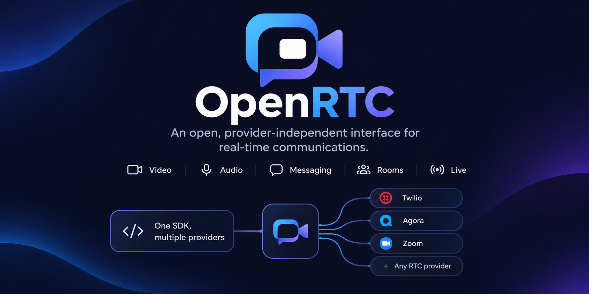

  

# OpenRTC

OpenRTC is a provider-independent, application-facing interoperability contract for real-time audio, video and calling. It specifies observable behavior: session lifecycle, participant identity and membership, media operations, events, capability discovery, errors, resource ownership and security. It does not specify a wire protocol or an implementation architecture.

The specification is a single RFC-style document: **[rfcs/openrtc-core.md](rfcs/openrtc-core.md)**.

| Section | Contents |
| --- | --- |
| §§1–6 | Abstract, conventions, introduction, terminology, scope, roles |
| §7 | Core operations, including the operation-requirement table (§7.0) |
| §§8–9 | Session and media behavior, error handling |
| §§10–11 | Extensibility and optional profiles (Calling, Manual Subscription, Source Replacement and Sharing, Screen Sharing, Data Messaging, Recording, Placement, End-to-End Encryption, Server Administration, Devices and Statistics, Credential Renewal) |
| §§12–14 | Security, privacy, conformance |
| Appendix A | Language-neutral interface definition |
| Appendix B | Traceability from earlier requirement identifiers |
| Appendix C | Non-normative implementation guidance |
